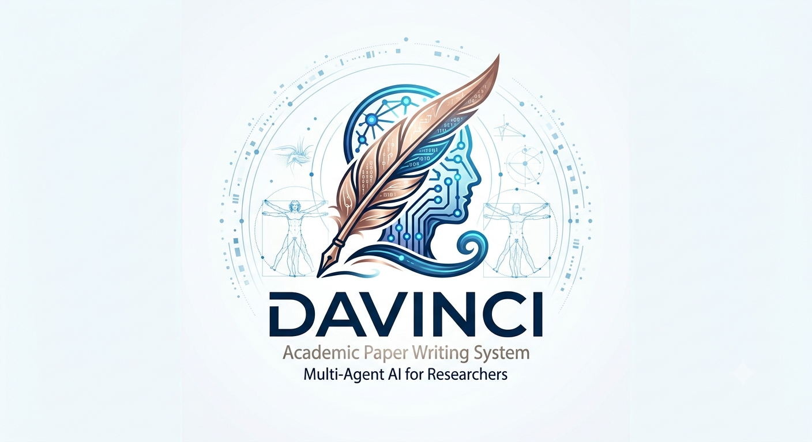

<h1 align="center">DaVinci — Academic Paper Writing System</h1>

<p align="center">
  
</p>

<h3 align="center">A multi-agent AI assistant for researchers — from sources to a submission-ready manuscript</h3>

<p align="center">
  v1.0.1 · Python 3.10+ · Streamlit · Docker ready · GPL v3.0
</p>

---

## What is DaVinci?

**DaVinci** is an AI-powered multi-agent system that assists a senior researcher in authoring publication-ready scientific papers. It ingests academic sources (theses, papers, research artefacts), learns your writing style, respects target venue formatting requirements, and produces manuscripts suitable for conference or journal submission.

It combines a prompt-engineered multi-agent workflow, defined in Markdown and run through GitHub Copilot or Claude Code, with an optional browser-based Web UI (`web/`) built on Streamlit — no coding required.

---

## At a Glance

| | |
|---|---|
| **11 specialized agents** | One orchestrator (`academic-writer`) coordinating ingestion, style learning, drafting, compliance, review simulation, and more |
| **24 slash commands** | From the guided `/start` wizard to the full `/write-paper` pipeline |
| **13 pre-configured venues** | IEEE, ACM, Elsevier, Springer, NeurIPS, ICML, and more — or add your own |
| **Source-grounded citations** | Only works ingested from your `sources/` folders can be cited |
| **Runs your way** | VS Code + Copilot, Claude Code, browser Web UI, Docker, or Codespaces |

---

## Table of Contents

- [Responsible AI / EU AI Act Notice](#responsible-ai--eu-ai-act-notice)
- [Features](#features)
- [Quick Start](#quick-start)
- [Pipeline Overview](#pipeline-overview)
- [Agents](#agents)
- [Prompts (Slash Commands)](#prompts-slash-commands)
- [Workspace Structure](#workspace-structure)
- [Supported Venue Formats](#supported-venue-formats)
- [Usage](#usage)
- [Getting Started](#getting-started)
- [Contributing](#contributing)
- [Origins & Credits](#origins--credits)
- [Community Support (Optional)](#community-support-optional)
- [License](#license)

---

## Responsible AI / EU AI Act Notice

DaVinci Writer is an AI-assisted authoring tool. Every draft it produces requires human review before submission — you, the author, remain fully responsible for the accuracy, originality, and integrity of anything you publish. DaVinci Writer is a **deployer** of third-party general-purpose AI models (Anthropic Claude in the cloud, or a local model via Ollama/LM Studio); it does not train or provide any model itself. Our self-assessment is that this use case (drafting and checking academic manuscripts) falls under the EU AI Act's general transparency obligations (Article 50) rather than the high-risk regime in Annex III. See **[Responsible AI & EU AI Act Notice](docs/RESPONSIBLE-AI.md)** for the full notice, including data-flow details (cloud vs. local) and AI-use disclosure guidance for your manuscripts.

## Features

- **Multi-Agent Architecture** — 11 specialized agents orchestrated by a single entry point (`academic-writer`), coordinating source ingestion, style learning, section drafting, compliance checking, peer review simulation, citation verification, writing quality analysis, integrity checking, revision management, and self-plagiarism detection.
- **Thesis-Aware Source Ingestion** — Automatically detects whether a source is a thesis, paper, or research artefact. Theses get multi-chapter summaries with cross-cutting themes, citable claims with page references, and research questions. Papers get standard structured summaries. Artefacts get content extraction with validation potential assessment.
- **Ownership Tagging** — Every ingested source is tagged with ownership (self vs. other) based on its folder. Self-owned material (theses, artefacts) drives contribution sections; other-owned material (papers) drives positioning sections. This separation ensures the paper is a novel contribution, not a literature review.
- **Source Quality Assessment** — Each ingested source receives a quality score (publication tier, recency, methodological rigor, evidence strength, relevance, ownership) that guides how prominently it should be cited and where in the paper it belongs.
- **Paper Type Awareness** — Recommends the appropriate paper type based on your sources: Design Science Research, Solution Proposal with Validation, Mixed-Methods Study, Full Research Paper, Systems Paper, or Experience Report. Each type has a tailored section structure.
- **Style Learning** — Analyzes your previously published papers to capture sentence rhythm, hedging patterns, transition phrases, citation density, section-level voice, and deep argumentation patterns (how you build arguments, handle limitations, position competitively, and calibrate claim strength). Produces a reusable style profile applied to every section.
- **Source-to-Section Mapping** — Before drafting, builds a map linking each ingested source (at the chapter level for theses) to the paper sections it feeds, ensuring every claim is traceable.
- **Novelty Validation** — Before drafting, explicitly validates each stated contribution against ingested sources to ensure genuine novelty. Produces a novelty matrix and flags contributions with unclear differentiators.
- **RQ-Validation Traceability** — Maps each research question to its validation method and evidence source. Ensures every RQ is stated in the Introduction, addressed in Methodology, evidenced in Validation, answered in Discussion, and summarized in Conclusion. Flags RQs without validation data.
- **Grey Literature & Artefact Citation** — Provides transparent, academically acceptable guidance for citing unpublished self-authored material: inline description for original contributions, technical report citations for institutional work, and DOI-bearing replication packages for data.
- **Page Budget Enforcement** — Computes per-section word targets (target = venue page limit − 1 page) and enforces ±10% tolerance during drafting and compliance checking.
- **Figure and Table Planning** — After drafting, produces a figure/table strategy with prioritized visual elements, draft captions, and placement placeholders.
- **Reference Integrity** — Hard constraint across all agents: the paper may **only** cite works that were ingested from `sources/papers/`, `sources/theses/`, or `sources/artefacts/` (artefacts cited as grey literature / `@techreport`). No hallucinated, fabricated, or memorized references — ever. Verified at drafting, coherence pass, and compliance check.
- **Coherence Pass** — After all sections are drafted, verifies contribution alignment (Introduction ↔ Results), abstract consistency, acronym definitions, terminology uniformity, cross-references, and limitation honesty.
- **Humanizer** — drafting applies the compact `academic-tells.md` reference (academic AI-tell patterns and vocabulary list); the full `humanizer.md` (37 before/after patterns) is applied by `/check-quality`.
- **Venue Compliance** — Validates the manuscript against IEEE, ACM, Elsevier/Springer, NeurIPS/ICML/ICLR, ACL/EMNLP, USENIX/CCS, or custom venue guidelines. Checks structure, length, citations, blind review, ethics, reproducibility, and contribution specificity. Now also identifies **strengths** to protect during revision.
- **Convergence-Based Iteration** — Compliance → revision loop continues until zero critical issues remain and warnings stabilize (up to 5 iterations), with integrated depth improvement. Tracks word count deltas across iterations.
- **Peer Review Simulation** — Simulates feedback from four reviewer personas (methodologist, domain expert, skeptic, and — for empirical papers only — a reproducibility auditor) to anticipate real peer review objections before submission. Produces a vulnerability register for rebuttal preparation.
- **Multi-Paper Coherence** — Publication portfolio tracker prevents self-plagiarism, enforces consistent terminology across paper series, and tracks which source material has been published.
- **Abstract-First or Abstract-Last** — Supports both workflows: outline-driven (abstract first, to set direction) or synthesis-driven (abstract last, after all content is complete).
- **Custom Section Names** — Supports non-standard section names (e.g., "System Design" instead of "Methodology") configured at the start of the pipeline.
- **Source Conflict Resolution** — When multiple sources cover overlapping topics, the orchestrator applies explicit rules: combine complementary sources, present the stronger-evidenced claim for contradictions, prefer the more recent or detailed source for redundancy.
- **Mandatory Venue Selection** — Every entry point requires a confirmed target venue before proceeding, ensuring the page budget, formatting, citation style, and compliance check are always venue-aware.
- **Contribution Framing Workshop** — Evaluates 2–3 alternative framings of the same research (methodological, empirical, DSR) against the venue's review criteria, recommending the angle most likely to lead to acceptance.
- **Methodology Stress-Test** — Before drafting, proactively identifies threats to validity (construct, internal, external, conclusion), missing baselines, and reproducibility gaps so they can be addressed in the paper rather than discovered by reviewers.
- **"So What?" Significance Test** — Post-draft pass that catches the #1 rejection reason: paragraphs that describe without justifying. Flags dead-end paragraphs, uninterpreted results, unjustified decisions, and missing implications.
- **Strategic Related Work Positioning** — Guides Related Work writing to strategically position the contribution: foreground gold-standard comparisons, build progressive-improvement narratives, and construct gap statements that lead naturally to your approach.
- **Venue-Specific Reviewer Calibration** — The reviewer simulator adjusts strictness and criteria weights based on venue type (top conference vs. journal vs. workshop), acceptance rate, and published review criteria.
- **Rebuttal Drafting** — Produces point-by-point responses to peer review feedback (simulated or real) with evidence mapping, proposed text changes, and appropriate academic tone.
- **Formal Peer Review Feedback Loop** — When given real reviewer scores and comments, automatically generates a revision matrix, per-item action classification (accept / partial / rebuttal-only), and a structured rebuttal letter draft.
- **Co-Author Feedback Integration** — Accepts freeform co-author/advisor comments, maps them to sections, proposes edits, and tracks which feedback is addressed vs. deferred.
- **Claim-to-Source Trace** — Every factual claim in a drafted section is linked to a specific passage in an ingested source summary. Unsupported claims are flagged `[UNSUPPORTED — author to verify]` rather than silently invented.
- **Canonical Reference Registry** — Maintains a concept → BibTeX key map (`output/knowledge/canonical-refs.md`) so the same concept always resolves to the same citation across all sections.
- **Citation Density Check** — Compliance checker benchmarks citation count against venue family norms (IEEE 8-page ≈20–30, ACM CHI ≈25–40, journals ≈30–60) and flags both sparse and padded reference lists.
- **Gap Statement Stress-Test** — Forces the researcher to name the strongest prior work, state a measurable differentiator, and produce a one-sentence gap statement per contribution before any section is drafted.
- **Statistical Rigour Checklist** — Paper Writer applies a mandatory checklist for every quantitative claim: correct test selection (t-test, ANOVA, Wilcoxon, Chi-square, etc.), effect sizes, confidence intervals, and baseline naming. Missing baselines are flagged `[TODO: baseline required]`.
- **Reproducibility Checklist** — Compliance checker generates a `reproducibility-checklist.md` covering code, dataset, hyperparameters, seeds, compute environment, evaluation protocol, and pre-registration status.
- **Ethics Statement Generator** — Auto-generates a compliant ethics statement with two templates (human subjects / technical artefacts only), marked for author review.
- **Reviewer 4 — Reproducibility Auditor** — A fourth simulated reviewer (empirical papers only) focuses exclusively on hyperparameter reporting, dataset description adequacy, statistical test appropriateness, seeds, and hardware specs.
- **Research Agenda Planning** — Analyzes unpublished source material to propose 2–5 future papers with target venues, publication sequencing, dependency graphs, and self-plagiarism prevention rules.
- **Submission Package Generation** — Produces cover letter, highlights, suggested reviewers, data availability statement, CRediT author contributions, and pre-submission checklist.
- **Elevator Pitch Generation** — Automatically generates a 1-paragraph summary alongside the final assembly, useful for cover letters, conference talks, and social media.

## Quick Start

### For beginners (recommended)

Just type one command — the system will guide you through everything:

```text
> /start
```

See [QUICKSTART.md](docs/QUICKSTART.md) for a visual 3-step guide, or read the **[User Manual](docs/USER-MANUAL.md)** for a complete walkthrough with screenshots.

### Web UI (no VS Code needed)

Use the browser-based interface if you prefer not to use VS Code.

**Quickest method (release package):**
1. Unzip `DaVinci-v1.0.1.zip` to a folder.
2. Start the app:
   - macOS: double-click **`Start DaVinci.command`**
   - Windows: double-click **`start.bat`**
   - A terminal window opens showing **6-phase startup progress**:
     ```
     ==========================================
       DaVinci Writer -- Startup Progress
     ==========================================
     [1/6] Checking Python version...
     [1/6] Python 3.11.7 found ✓
     [2/6] Virtual environment exists ✓
     [3/6] Dependencies already up to date ✓
     [4/6] Configuration file found ✓
     [5/6] Application process started ✓
     [6/6] Application is ready ✓

     ==========================================
       DaVinci is running!
       URL: http://localhost:8501
       To stop: run stop.bat
     ==========================================
     ```
   - Your browser automatically opens to **http://localhost:8501** when ready
3. The launcher installs or updates dependencies only when needed (first run, or when `web/requirements.txt` changes), then opens your browser automatically.
4. Open **⚙️ Settings** from the sidebar to configure your Anthropic API key (or add it to a `.env` file: `ANTHROPIC_API_KEY=sk-ant-your-key-here`).
5. Stop the app when done:
   - macOS: double-click **`Stop DaVinci.command`**
   - Windows: double-click **`stop.bat`**
   - A terminal window opens showing **3-phase shutdown progress**:
     ```
     ==========================================
       DaVinci Writer - Stopping
     ==========================================
     [1/3] Checking if application is running...
     [1/3] Application found running on port 8501 ✓
     [2/3] Stopping application...
     [2/3] Stop signal sent ✓
     [3/3] Verifying application stopped...
     [3/3] Port 8501 is now free ✓
     
     ==========================================
       Application stopped successfully!
     ==========================================
     ```

**Manual start (Python 3.10+):**
```bash
cd web
pip3 install -r requirements.txt
streamlit run app.py
```

Open http://localhost:8501.

**Docker:**
```bash
cp .env.example .env   # then add your ANTHROPIC_API_KEY
docker compose up
```

Open http://localhost:8501. Stop with `docker compose down`.

**What the Web UI includes:** a step-by-step wizard guides your writing workflow, alongside these tools:

- **🎯 14 goal cards** — Write a Paper, Import Paper, Literature Review, Plan Publications, Improve Draft, Peer Review, Quality Check, Final Audit, Convert Format, Prepare Submission, Revise Paper, Draft Rebuttal, Coach Revision, and Integrate Feedback.
- **📝 Papers Editor** — Open any generated paper, select a section from the list, edit it in a full-height text area, and save directly to disk.
- **📂 Sources Manager** — Browse, preview, upload, and delete files in your `sources/` folders, and view ingested knowledge summaries.
- **📄 Output Manager** — Browse, preview, and download all generated manuscripts and reports.
- **⚙️ Settings** — Choose your provider (Anthropic cloud or a local endpoint), configure and verify your API key with Save & Test, pick a Claude model (Sonnet 5 / Opus 5 / Haiku 4.5) from comparison cards, enable Economy routing, track session costs, and switch between System, Dark, and Light themes.
- **🛡️ Responsible AI** — A sidebar page with the EU AI Act notice and data-flow details (cloud vs. local).
- **🤝 Optional Support** — A subtle Support entry in the Help section, an About-page support card, and a one-time hint after a pipeline completes link to Ko-fi for voluntary tips (no paywalls, no feature gating).
- **💾 Session Persistence** — Sessions auto-save after each message; resume any of your five most recent sessions from the sidebar after closing the browser.

#### Screenshots

<p align="center">
  
</p>

<p align="center">
  
  &nbsp;
  
</p>

See the **[User Manual](docs/USER-MANUAL.md)** for a screen-by-screen walkthrough.

#### Using a local model (Ollama) — cost-free option

The Web UI can run against a **local model** instead of Anthropic cloud, using any
server that supports the Anthropic Messages API. The tested recipe uses
[LiteLLM](https://docs.litellm.ai/) in front of [Ollama](https://ollama.com/):

```bash
# 1. Pull a tool-capable model (required — the pipeline is tool-driven)
ollama pull qwen2.5:14b

# 2. Start the translation proxy
pip install "litellm[proxy]"
litellm --model ollama_chat/qwen2.5:14b --port 4000
```

Then open **⚙️ Settings → Connection**, choose **Local endpoint**, enter
`http://localhost:4000`, click **Test connection** to fetch the model list, then click
**Use this endpoint**. No API key is needed while a local endpoint is active,
and session cost is shown as free. Equivalent `.env` configuration:
`ANTHROPIC_BASE_URL` + `ANTHROPIC_MODEL` (see `.env.example`).

> ⚠️ **Set expectations:** local models are substantially weaker than Claude on this
> pipeline (tool-calling reliability, context window, writing quality). They are best
> for lightweight tasks like importing papers, format conversion, and early drafts.
> For final paper generation, use cloud models. Prompt caching and Economy Model
> Routing are cloud-only and are disabled automatically.

### GitHub Codespaces (zero install)

Click the green **"Code"** button on the repository page → **"Open with Codespaces"**. A fully configured environment opens in your browser with all extensions pre-installed.

### Automated (experienced users)

Run a single command to execute the entire pipeline — source ingestion, style learning, page budgeting, drafting, coherence checking, compliance validation, and assembly:

```text
> /write-paper
```

To improve and extend an existing draft to publication-ready length and quality:

```text
> /improve-paper
```

### Manual (step-by-step)

| Step | Command | What it does |
|------|---------|-------------|
| 1 | `/ingest-sources` | Reads theses, papers, and artefacts from `sources/`, produces structured summaries in `output/knowledge/sources/` |
| 2 | `/learn-style` | Analyzes your papers in `sources/my-papers/`, saves a style profile to `output/knowledge/style-profile.md` |
| 3 | `/set-venue` | Configures the target venue and generates `requirements-summary.md` from guidelines in `sources/venues/` |
| 4 | `/set-page-budget` | Computes per-section word targets (page limit − 1) and saves to `sources/venues/<venue>/page-budget.md` |
| 5 | `/plan-paper` | Reviews your sources and recommends a paper structure, contributions, and gap analysis for the venue |
| 6 | `/new-paper` | Starts drafting (sources must already be ingested; use `/write-paper` for full pipeline) |
| 7 | `/improve-paper` | Deepens, expands, and polishes an existing draft to meet venue page requirements |

## Pipeline Overview

```
Phase 0  Collect Requirements     → venue (mandatory), title/contributions (optional)
Phase 1  Validate Prerequisites   → bootstrap directories, sources, venue guidelines, page budget (auto-generated if absent)
Phase 2  Ingest Sources           → thesis + paper + artefact extraction with ownership tagging → output/knowledge/sources/
Phase 2b Propose Paper Plan       → paper type, title, RQs, contributions, structure (from self-owned sources)
Phase 3  Learn Writing Style      → style-learner → output/knowledge/style-profile.md
Phase 4  Workspace + Source Map   → brief.md with ownership-aware source-to-section mapping
Phase 4b RQ-Validation Traceability → map each RQ to validation method and evidence source
Phase 4c Novelty Validation       → validate contributions against ingested sources
Phase 4d Contribution Framing     → evaluate alternative framings against venue review criteria
Phase 4e Methodology Stress-Test  → identify threats to validity before drafting
Phase 5  Draft Sections (×8)      → paper-writer drafts each section with narrative continuity + quick validation
         Coherence Pass           → reference traceability, contribution alignment, abstract↔results, acronyms
Phase 5b "So What?" Test          → flag dead-end paragraphs, uninterpreted results, unjustified decisions
Phase 5d Figure/Table Planning    → produce visual strategy with captions and placements
Phase 5e Self-Plagiarism Check    → compare against sources/my-papers/ and sources/theses/; rewrite if HIGH/CRITICAL overlap
Phase 5f Integrity Gate           → integrity-check verifies consistency + failure modes; FAIL blocks compliance
Phase 6  Compliance Check         → compliance-checker validates venue rules + page budget; citation-verifier checks references
Phase 7  Revise (convergence)     → fix issues until PASS: 0 critical + warnings stabilize (max 5 iterations)
Phase 8  Peer Review Simulation   → reviewer-simulator provides venue-calibrated 4-persona feedback
                                    (4th persona — reproducibility auditor — for empirical papers only)
Phase 9  Assemble Full Paper      → after user confirmation → output/<paper-slug>/full-paper.md + elevator pitch
Phase 10 Final Delivery           → summary with word counts, page estimate, compliance status, review verdict
Phase 11 Session Learnings        → append session-learnings.md + update portfolio-tracker.md
```

## Agents

| Agent | Role | Type |
|-------|------|------|
| `academic-writer` | Orchestrator — drives the end-to-end pipeline with gap-statement stress-test, pre-empted objections, and mid-pipeline reinforcement | User-facing |
| `source-ingestion` | Reads theses, papers, and artefacts; produces structured knowledge summaries with quality assessment and ownership tagging | Subagent |
| `style-learner` | Analyzes past papers to capture the researcher's writing voice and argumentation patterns | Subagent |
| `paper-writer` | Drafts individual paper sections with claim-to-source tracing, canonical reference registry, statistical rigour checks, and anti-leakage protocol | Subagent |
| `compliance-checker` | Validates the manuscript against venue rules, page budget, reference integrity, citation density, and reproducibility | Subagent |
| `reviewer-simulator` | Simulates peer review from 4 personas (methodologist, domain expert, skeptic, reproducibility auditor) with anti-sycophancy protocol | Subagent |
| `revision-specialist` | Revises papers based on real peer reviewer feedback; audits sources, builds response matrix, rewrites manuscript | Subagent |
| `citation-verifier` | Verifies all references are real, traceable to ingested sources, and correctly attributed; flags fabricated citations | Subagent |
| `writing-quality-check` | Detects AI-generated writing patterns, overused filler words, and stylistic issues; produces per-section quality grades | Subagent |
| `integrity-check` | Content integrity gate + score trajectory tracking; verifies cross-section consistency and temporal integrity | Subagent |
| `self-plagiarism-guard` | Compares new paper against author's prior publications; flags textual overlap that would trigger iThenticate/Turnitin | Subagent |

## Prompts (Slash Commands)

| Command | Purpose |
|---------|---------|
| `/start` | **Recommended** — guided wizard that detects your setup and runs the right pipeline |
| `/help` | Status dashboard — shows what you have, what's missing, and suggests next steps |
| `/write-paper` | Full automated pipeline — ingestion through final delivery |
| `/improve-paper` | Expand and polish an existing draft to publication-ready quality |
| `/plan-paper` | Source audit and recommended paper structure (planning only, no output files) |
| `/set-page-budget` | Compute per-section word targets from venue page limit |
| `/new-paper` | Start drafting (sources must already be ingested; use `/write-paper` for full pipeline) |
| `/ingest-sources` | Ingest all documents in `sources/theses/`, `sources/papers/`, and `sources/artefacts/` |
| `/set-venue` | Configure the target venue and generate a requirements summary |
| `/learn-style` | Build a writing style profile from `sources/my-papers/` |
| `/simulate-review` | Simulate peer review with 4 reviewer personas before submission |
| `/draft-rebuttal` | Draft a point-by-point rebuttal to reviewer feedback |
| `/get-feedback` | Integrate co-author or advisor feedback into the paper |
| `/plan-agenda` | Plan a multi-paper publication strategy from available sources |
| `/prepare-submission` | Generate cover letter, highlights, suggested reviewers, and checklists |
| `/coach-revision` | Socratic revision coaching — guides you through reviewer comments one by one |
| `/final-audit` | Fresh-context pre-submission verification pass |
| `/revise-paper` | Systematic revision based on real peer reviewer feedback |
| `/verify-citations` | Check that all references are real, traceable, and correctly attributed |
| `/check-quality` | Detect AI-generated patterns, overused terms, and style deviations |
| `/lit-review` | Produce a thematic literature map and gap analysis from ingested sources |
| `/convert-format` | Convert a paper between venue formats (e.g., IEEE → Springer) |
| `/import-paper` | Bring an externally-written paper into the workspace for revision or improvement |
| `/check-plagiarism` | Compare your new paper against prior publications for self-plagiarism |

## Workspace Structure

```
DaVinci/
├── sources/                          ← Researcher-provided inputs (read-only)
│   ├── theses/                       ← Master's and PhD theses (ownership: self)
│   ├── artefacts/                    ← Your unpublished materials: design docs, surveys, experiments (ownership: self)
│   ├── papers/                       ← Reference and related-work papers (ownership: other)
│   ├── my-papers/                    ← Your own past publications (style learning only)
│   ├── submitted-papers/             ← Externally-written papers for import into the pipeline
│   ├── reviewer-feedback/            ← Real reviewer comments received after submission
│   ├── my-response-letters/          ← Previously written rebuttal/response letters
│   └── venues/                       ← Venue guidelines and requirements
│       └── <venue-slug>/
│           ├── requirements-summary.md
│           └── page-budget.md
│
├── output/                           ← All generated artefacts
│   ├── knowledge/                    ← Persistent cross-session memory (DO NOT DELETE)
│   │   ├── sources/                  ← One .md summary per ingested source (with quality + ownership)
│   │   ├── style-profile.md         ← Learned writing style profile (incl. argumentation)
│   │   ├── response-letter-profile.md ← Rebuttal/response letter style profile
│   │   ├── canonical-refs.md        ← Concept → BibTeX key registry
│   │   ├── portfolio-tracker.md     ← Multi-paper coherence and self-plagiarism guard
│   │   └── session-learnings.md     ← Accumulated lessons from past sessions
│   └── <paper-slug>/                ← One folder per paper
│       ├── brief.md                  ← Paper brief with source-to-section map
│       ├── rq-traceability.md       ← RQ → validation method → evidence mapping
│       ├── novelty-matrix.md        ← Contribution novelty validation
│       ├── methodology-stress-test.md ← Pre-draft validity threat analysis
│       ├── figure-plan.md           ← Figure/table strategy with captions
│       ├── abstract.md
│       ├── introduction.md
│       ├── related-work.md
│       ├── methodology.md
│       ├── experiments-or-results.md
│       ├── discussion.md
│       ├── conclusion.md
│       ├── references.bib            ← BibTeX (only from ingested sources)
│       ├── compliance-report.md
│       ├── peer-review-simulation.md ← Simulated 4-persona peer review
│       ├── citation-verification-report.md ← Citation integrity check results
│       ├── writing-quality-report.md ← AI-tell detection and quality grades
│       ├── quality-scorecard.md     ← Integrity check score trajectory
│       ├── self-plagiarism-report.md ← Overlap analysis against prior publications
│       ├── reviewer-response-matrix.md ← Reviewer feedback action items (/revise-paper)
│       ├── rebuttal-draft.md        ← Point-by-point reviewer response (/draft-rebuttal)
│       ├── elevator-pitch.md        ← 1-paragraph summary for cover letters
│       └── full-paper.md            ← Assembled final manuscript
│
├── .github/
│   ├── agents/                       ← 11 agent definitions (.agent.md)
│   ├── prompts/                      ← 24 slash-command entry points (.prompt.md)
│   ├── instructions/                 ← 3 always-active guardrails
│   │   ├── academic-writing.instructions.md
│   │   ├── citation-standards.instructions.md
│   │   └── venue-compliance.instructions.md
│   └── skills/
│       └── academic-writer/
│           ├── SKILL.md
│           └── references/
│               ├── humanizer.md              ← 37 AI-tell removal patterns (used by /check-quality)
│               ├── academic-tells.md         ← Compact AI-tell patterns applied during drafting
│               ├── source-summary-format.md  ← Schema for ingested summaries
│               ├── style-profile-format.md   ← Schema for style profiles
│               ├── session-learnings-format.md ← Schema for session learnings log
│               ├── portfolio-tracker-format.md ← Schema for multi-paper coherence tracker
│               ├── ai-failure-modes.md       ← AI research failure modes checklist
│               └── venue-families.md         ← Quick-ref venue formatting rules
│
├── web/                              ← Browser-based Streamlit UI (no VS Code needed)
│   ├── app.py                        ← Main web application
│   ├── davinci_core.py               ← Shared helpers used by the app and tests
│   ├── requirements.txt
│   └── README.md
│
├── tests/                            ← pytest suite for davinci_core
├── static/images/                    ← Logo used by this README
│
├── docs/                             ← Documentation and screenshots
│   ├── USER-MANUAL.md                ← Complete walkthrough guide
│   ├── ABOUT.md                      ← Project overview and version info
│   ├── QUICKSTART.md                 ← 3-step beginner guide
│   ├── ARCHITECTURE.md               ← Detailed system architecture
│   ├── RESPONSIBLE-AI.md             ← Responsible AI & EU AI Act notice
│   └── images/                       ← Step-by-step screenshots
│
├── scripts/
│   ├── bump-version.sh               ← Updates the version string across app.py, README, ABOUT.md
│   ├── make-release.sh               ← macOS release build script (also used by CI)
│   ├── macos/                        ← macOS-specific launch scripts
│   │   ├── run-webui.command
│   │   └── stop-webui.command
│   └── windows/                      ← Windows-specific launch scripts
│       ├── setup.bat / setup.ps1
│       ├── run-webui.bat / run-webui.ps1
│       └── stop-webui.bat / stop-webui.ps1
│
├── .devcontainer/                    ← GitHub Codespaces / devcontainer config
│   └── devcontainer.json
│
├── AGENTS.md                         ← Agent overview (read by GitHub Copilot)
├── CLAUDE.md                         ← Points to AGENTS.md (read by Claude Code)
├── Dockerfile / docker-compose.yml   ← Container setup for the Web UI
├── .env.example                      ← Template for ANTHROPIC_API_KEY and local-endpoint settings
├── start.bat                         ← Double-click to launch (Windows)
├── stop.bat                          ← Double-click to stop (Windows)
├── Start DaVinci.command             ← Double-click to launch (macOS)
├── Stop DaVinci.command              ← Double-click to stop (macOS)
├── LICENSE.md                        ← GNU General Public License v3.0
└── README.md                         ← This file
```

## Supported Venue Formats

| Family | Sub-types |
|--------|-----------|
| **IEEE** | Conferences (two-column), Transactions, Access (journal) |
| **ACM** | SIG proceedings, journals |
| **Elsevier / Springer** | LaTeX and Word journal templates, LNCS |
| **NeurIPS / ICML / ICLR** | ML conference proceedings |
| **ACL / EMNLP / NAACL** | NLP conference proceedings |
| **USENIX / CCS / IEEE S&P** | Security conference proceedings |
| **Custom** | Place raw guidelines in `sources/venues/` |

**Pre-configured venues (13):** IEEE Access, IEEE TSE, Elsevier JSS, Elsevier IST, Springer EMSE, ICSE, ACM FSE, ACM CHI, IEEE ICASSP, NeurIPS, ICML, INForum, REFSQ.

## Conventions

- All manuscript drafts are Markdown (`.md`) files in `output/`.
- Section files follow the pattern `output/<paper-slug>/<section>.md`.
- Citations are collected in `output/<paper-slug>/references.bib` (BibTeX). **Only references from ingested sources are permitted.**
- A compliance report is written to `output/<paper-slug>/compliance-report.md` after each draft.
- The assembled manuscript is at `output/<paper-slug>/full-paper.md`.
- Ingested source summaries persist in `output/knowledge/sources/` between sessions. **Do not delete this folder.**
- The style profile persists at `output/knowledge/style-profile.md`. **Do not delete this file.**

## Usage

### With GitHub Copilot (VS Code)

All agents and prompts work natively in VS Code with GitHub Copilot Chat. Use slash commands directly:

```text
> /write-paper a paper on transformer-based speech enhancement for IEEE ICASSP 2026
> /plan-paper
> /improve-paper
```

Or invoke the orchestrator agent:

```text
> @academic-writer Write a paper titled "..." for IEEE Access.
```

### With Claude Code

Run the orchestrator from the Claude Code CLI:

```text
> Use the academic-writer agent to write a paper titled "..." for IEEE ICASSP 2026.
```

Or invoke individual slash commands:

```text
> /write-paper
> /improve-paper
> /plan-paper
```

## Getting Started

1. Clone the repository:

   ```bash
   git clone https://github.com/ribeiroe/DaVinci_Writer.git
   cd DaVinci_Writer
   ```

2. Add your source materials:
   - Place theses in `sources/theses/`
   - Place reference papers in `sources/papers/`
   - Place your own past publications in `sources/my-papers/` (optional, for style learning)
   - Place venue guidelines in `sources/venues/<venue-name>/`

3. Run `/write-paper` to execute the full pipeline, or follow the manual steps in the Quick Start section above.

The agent workflow needs no build step or installation — just an AI runtime (GitHub Copilot or Claude Code) and your source documents. The optional Web UI additionally needs Python 3.10+ and the packages in `web/requirements.txt`.

## Contributing

Contributions are welcome! Please read [AGENTS.md](AGENTS.md) and [ARCHITECTURE.md](docs/ARCHITECTURE.md) for detailed guidance on extending agents or adding new features.

## Origins & Credits

DaVinci Writer is a locally-run, multi-agent system that turns theses, papers, and research artefacts into publication-ready manuscripts. The workflow is defined as Markdown agents and prompts that run in GitHub Copilot or Claude Code, with an optional Streamlit Web UI so researchers can use it from the browser regardless of coding experience.

DaVinci Writer brings together work from distinct sources. Each is credited and cited separately below to avoid confusion.

### 1. This application — DaVinci Writer

- **Author**: J. Eduardo Ferreira Ribeiro
- **Contributors**: António Campos, Nuno Pessoa Soares

If DaVinci Writer helped produce a paper, thesis, or report, please cite it as:

```bibtex
@software{ribeiro2026davinci,
  author  = {Ferreira Ribeiro, J. Eduardo and Campos, António and Pessoa Soares, Nuno},
  title   = {DaVinci Writer: An AI-Powered Multi-Agent System for Academic Paper Writing},
  year    = {2026},
  version = {1.0.1},
  url     = {https://github.com/ribeiroe/DaVinci_Writer}
}
```

### 2. Research behind the failure-mode checks

The integrity gate and the AI research failure-mode checklist ([ai-failure-modes.md](.github/skills/academic-writer/references/ai-failure-modes.md)) are based on the limitations reported by Lu et al. (2026), *Nature* 651:914–919, the first fully autonomous AI research system to publish through blind peer review. If you cite the underlying findings, cite that work directly.

### 3. AI models and frameworks

DaVinci Writer does not train or provide any model. The Web UI uses Anthropic Claude through the Anthropic API (or a local model via Ollama, LM Studio, or LiteLLM) and is built with [Streamlit](https://streamlit.io/). Credit for those components belongs to their respective authors; see the [Responsible AI & EU AI Act Notice](docs/RESPONSIBLE-AI.md) for how the models are used.

## Community Support (Optional)

DaVinci Writer is free and will remain free under the GNU General Public License v3.0. If it helps your work, you can optionally support RibeiroLabs to help cover development, maintenance, and hosting costs. Tipping unlocks no features, no early access, no priority, and comes with no support commitment — tips are voluntary only.

- Ko-fi: [https://ko-fi.com/ribeirolabs](https://ko-fi.com/ribeirolabs)
- In-app locations: the sidebar Help section, the About page, and a one-time hint shown when a pipeline completes

---

## License

**DaVinci Writer** itself is released under the [GNU General Public License v3.0](LICENSE.md). It is provided as-is, without warranty of any kind (see the license, Sections 15 and 16).

See also: [Responsible AI & EU AI Act Notice](docs/RESPONSIBLE-AI.md).
