# DaVinci Writer — User Manual

> **Version:** 1.1.0 · **Last Updated:** October 2026
>
> A practical guide for turning theses, notes, and data into publication-ready scientific papers — no programming required.

---

## Table of Contents

1. [What is DaVinci Writer?](#1-what-is-davinci-writer)
2. [Two Ways to Use It](#2-two-ways-to-use-it)
3. [Getting Started (Web UI)](#3-getting-started-web-ui)
4. [Step-by-Step Walkthrough](#4-step-by-step-walkthrough)
   - [Step 1 — Choose Your Goal](#step-1--choose-your-goal)
   - [Step 2 — Pick Your Venue](#step-2--pick-your-venue)
   - [Step 3 — Add Paper Details](#step-3--add-paper-details)
   - [Step 4 — Generate Your Paper](#step-4--generate-your-paper)
5. [Understanding the Sidebar](#5-understanding-the-sidebar)
6. [Sources Manager](#6-sources-manager)
7. [Papers Editor](#7-papers-editor)
8. [Output Manager](#8-output-manager)
9. [Settings](#9-settings)
10. [Getting Started (VS Code)](#10-getting-started-vs-code)
11. [Preparing Your Source Materials](#11-preparing-your-source-materials)
12. [Supported Venues](#12-supported-venues)
13. [Available Commands (VS Code)](#13-available-commands-vs-code)
14. [Tips for Best Results](#14-tips-for-best-results)
15. [Responsible Use & AI Transparency](#15-responsible-use--ai-transparency)
16. [Frequently Asked Questions](#16-frequently-asked-questions)
17. [Troubleshooting](#17-troubleshooting)
18. [Credits & How to Cite](#18-credits--how-to-cite)

---

## 1. What is DaVinci Writer?

DaVinci Writer is an AI-powered assistant that helps senior researchers write publication-ready scientific papers. It:

- **Reads your sources** — theses, research artefacts, papers, and notes
- **Learns your writing style** — from your previously published papers
- **Drafts your manuscript** — section by section, following your venue's rules
- **Checks compliance** — against your target journal or conference formatting requirements
- **Simulates peer review** — four reviewer personas (the fourth, a reproducibility auditor, for empirical papers only) find weaknesses before real reviewers do
- **Assembles the final paper** — with references, consistent formatting, and an elevator pitch

You provide the research; DaVinci Writer does the writing.

---

## 2. Two Ways to Use It

| Method | Best For | Requirements |
|--------|----------|-------------|
| **Web UI** (browser) | Beginners, anyone without VS Code | Python 3.10+ (or Docker), an Anthropic API key (or a local Ollama/LiteLLM endpoint) |
| **VS Code + Copilot** | Advanced users, full control | VS Code, GitHub Copilot extension |

Both methods share the same workspace — files and outputs are compatible between them.

---

## 3. Getting Started (Web UI)

### Prerequisites

- **Python 3.10 or later** — [Download Python](https://www.python.org/downloads/)
- **An Anthropic API key** — [Get one here](https://console.anthropic.com/) (required for live generation). You can configure it in the app's **⚙️ Settings** page or in a `.env` file.

### Installation (Release Package)

1. **Unzip** the `DaVinci-v1.1.0.zip` release to a folder on your computer.

2. Start the app:
   - macOS: **Double-click `Start DaVinci.command`**
   - Windows: **Double-click `start.bat`**
   - A terminal window opens showing **6-phase startup progress**:
     ```
     [1/6] Checking Python version...       → Python 3.11.7 found ✓
     [2/6] Virtual environment exists       ✓
     [3/6] Dependencies already up to date  ✓
     [4/6] Configuration file found         ✓
     [5/6] Application process started      ✓
     [6/6] Application is ready             ✓
     ```
   - Your browser automatically opens to **http://localhost:8501** when the application is ready
   - Dependencies are installed on first run (or when `web/requirements.txt` changes)

3. Configure your API key:
   - In the app: open **⚙️ Settings → Connection**, paste your key, and click **Save & Test** (recommended), or
   - In a `.env` file in the DaVinci folder:
   ```
   ANTHROPIC_API_KEY=sk-ant-your-key-here
   ```

4. Stop the app when done:
   - macOS: double-click **`Stop DaVinci.command`**
   - Windows: double-click **`stop.bat`**
   - A terminal window opens showing **3-phase shutdown progress** and confirms that the application has stopped

OS-specific launcher scripts are also available in `scripts/macos/` and `scripts/windows/`.

> **macOS security:** If macOS blocks the `.command` file on first run, right-click → Open → Open. You only need to do this once.

### Manual Start (if not using the release package)

```bash
pip3 install -r web/requirements.txt
streamlit run web/app.py
```

Open your browser at [http://localhost:8501](http://localhost:8501).

### Docker (optional)

```bash
cp .env.example .env   # then add your ANTHROPIC_API_KEY
docker compose up
```

Open [http://localhost:8501](http://localhost:8501). Stop with `docker compose down`.

You should see the DaVinci Writer welcome screen:

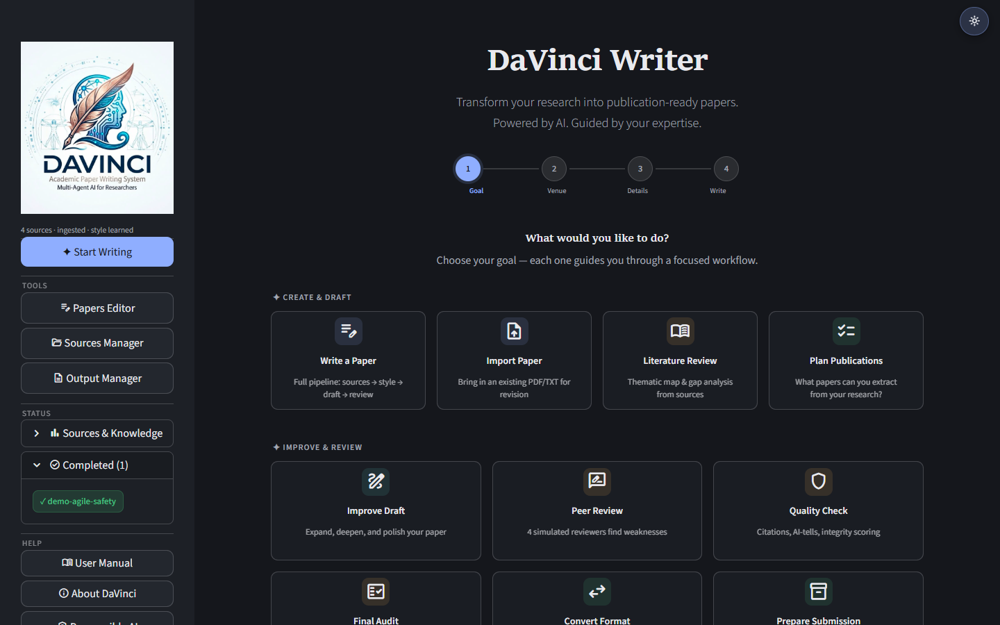
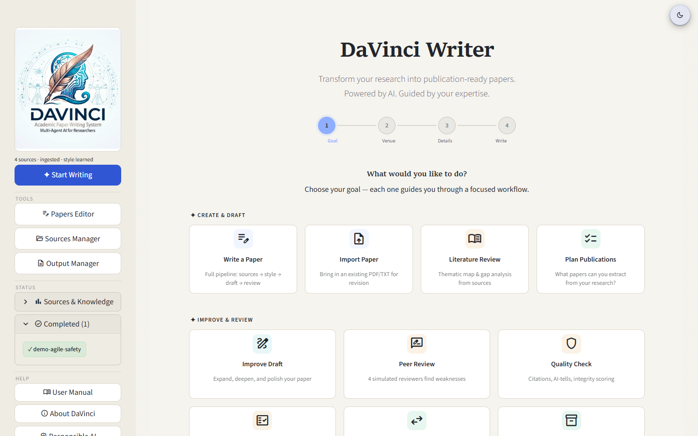

> Screenshot note: visuals can vary slightly by theme (Dark/Light) and minor releases.

---

## 4. Step-by-Step Walkthrough

DaVinci Writer guides you through a **4-step wizard**. A progress bar at the top shows your current step.

> **Shorter wizards:** goals that work on an existing paper or on your sources alone skip the venue step and show a **3-step** progress bar instead (for example *Goal → Paper & Feedback → Revise*). These are Quality Check, Final Audit, Convert Format, Draft Rebuttal, Coach Revision, Integrate Feedback, Import Paper, and Literature Review. **Plan Publications** jumps straight to the generation step.

### Step 1 — Choose Your Goal

When you open DaVinci Writer, you see goal cards organized into three categories:

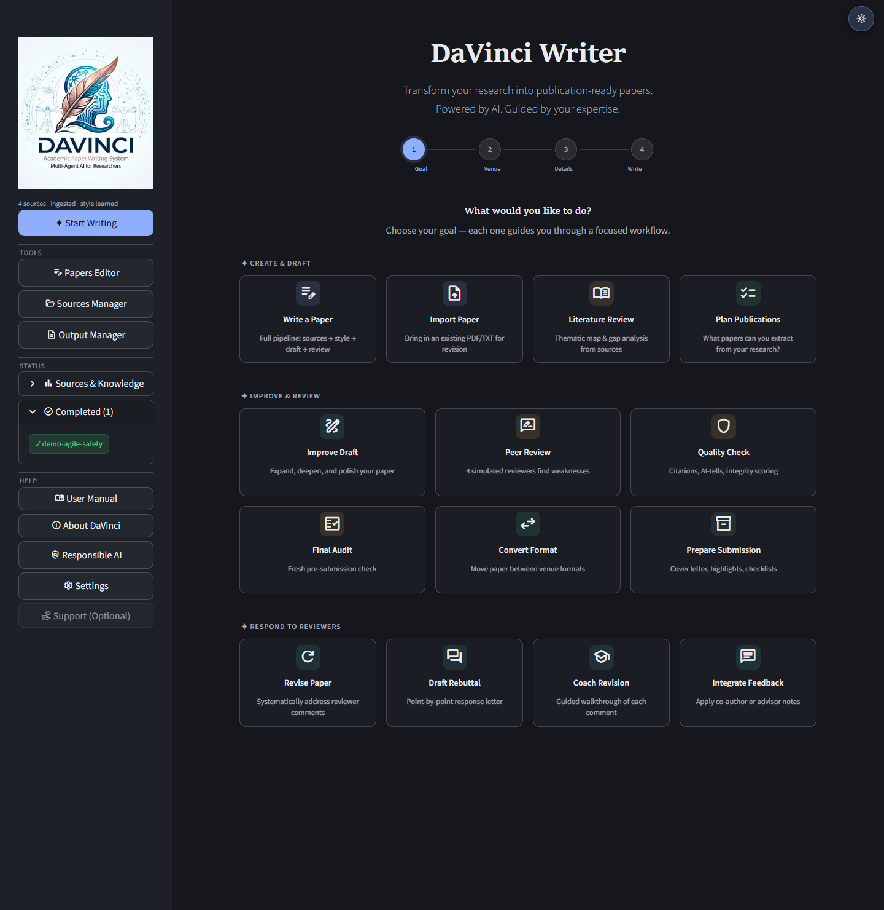

**✦ Create & Draft**

| Goal | What It Does |
|------|-------------|
| **✍️ Write a Paper** | Full pipeline: ingests your sources, learns your style, plans the structure, drafts every section, checks compliance, and simulates peer review |
| **📥 Import Paper** | Brings an externally-written paper (PDF, TXT, MD) into the workspace for revision or improvement |
| **📚 Literature Review** | Produces a thematic literature map and gap analysis from ingested sources |
| **🗺️ Plan Publications** | Analyzes your research materials and identifies extractable papers with a recommended sequence |

**✦ Improve & Review**

| Goal | What It Does |
|------|-------------|
| **✨ Improve Draft** | Takes an existing draft and expands, deepens, and polishes it |
| **🔬 Peer Review** | Simulates 4 reviewer personas who critique your paper |
| **🛡️ Quality Check** | Verifies citations, detects AI-writing patterns, scores integrity |
| **🔍 Final Audit** | Fresh-context pre-submission verification pass |
| **🔀 Convert Format** | Converts a paper between venue formats (e.g., IEEE → Springer) |
| **📦 Prepare Submission** | Generates a cover letter, highlights, suggested reviewers, and a pre-submission checklist |

**✦ Respond to Reviewers**

| Goal | What It Does |
|------|-------------|
| **🔄 Revise Paper** | Systematic revision based on real peer reviewer feedback |
| **💬 Draft Rebuttal** | Produces a point-by-point response to reviewer feedback |
| **🎓 Coach Revision** | Socratic coaching that guides you through reviewer comments one by one |
| **👥 Integrate Feedback** | Processes and applies co-author or advisor comments |

**How to proceed:** Click one of the goal cards. You'll advance to Step 2 (venue) or, for the shorter wizards above, straight to the details step.

If you have a saved session, a **"Continue where you left off"** banner with a **Resume** button appears above the cards. When a finished draft exists, a **"Suggested next step"** hint also points you to Improve, Quality Check, or Peer Review.

> **Tip:** If you're unsure, start with **"Write a Paper"** — it's the most comprehensive option and includes all the other steps.

---

### Step 2 — Pick Your Venue

Next, choose where you plan to submit your paper:

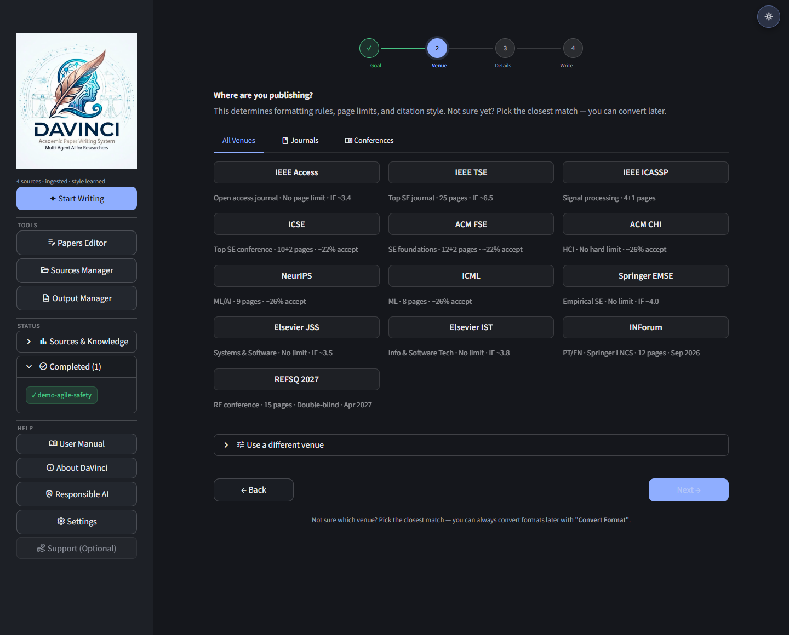

DaVinci Writer comes with **13 pre-configured venues** organized by type:

- **📗 Journals** — IEEE Access, IEEE TSE, Elsevier JSS, Elsevier IST, Springer EMSE
- **📘 Conferences** — ICSE, ACM FSE, ACM CHI, IEEE ICASSP, NeurIPS, ICML, INForum, REFSQ

Each venue appears as a card with a one-line caption (page limit, impact factor or acceptance rate, venue type); hover over a card for the same text as a tooltip.

**How to proceed:**

1. Use the tabs (**All Venues**, **Journals**, **Conferences**) to filter the list.
2. Click a venue card. A checkmark (✓) appears on the selected card.
3. Click **"Next →"** to continue.

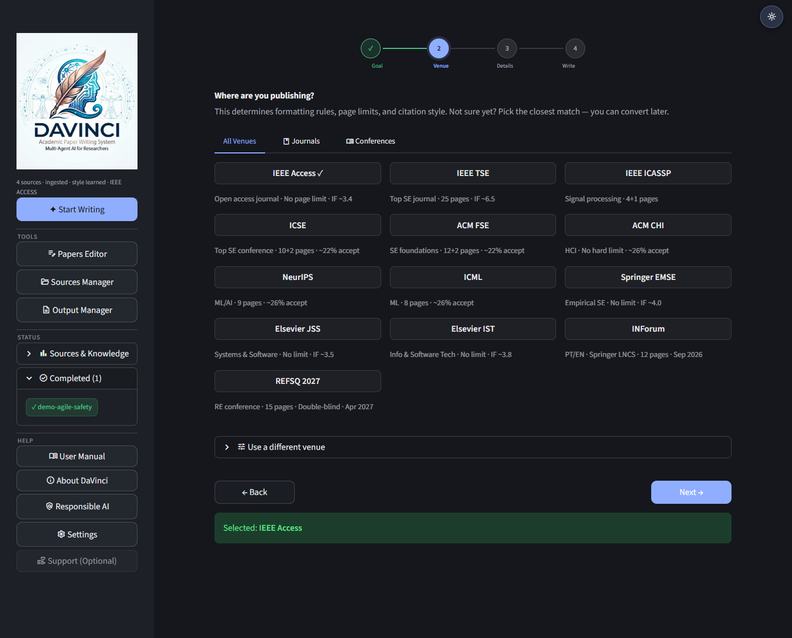

> **Using a different venue?** Click the **"🔧 Use a different venue"** expander at the bottom and type your venue name. You can also add guidelines files to `sources/venues/` in your workspace.

---

### Step 3 — Add Paper Details

This step lets you optionally provide a title, contributions, and upload source files:

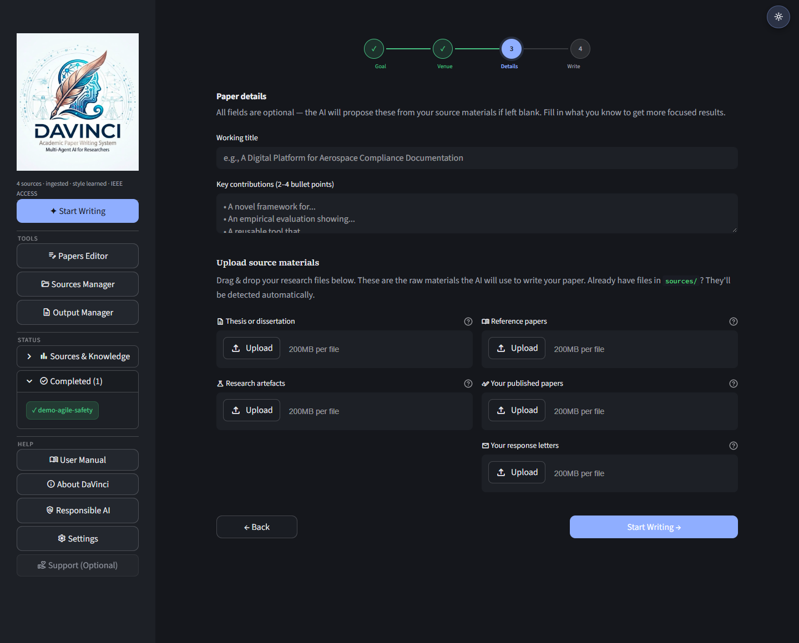

> **The fields depend on your goal.** The screenshot shows *Write a Paper*. Goals that work on an existing paper (Improve Draft, Peer Review, Prepare Submission, Quality Check, Final Audit, Convert Format, Rebuttal, Coach Revision, Integrate Feedback) first ask you to **select the paper** from your `output/` folder. Revise, Rebuttal, and Coach Revision also let you paste reviewer comments or upload a feedback file (`.txt`, `.md`, `.pdf`). Import Paper asks for a paper slug and a PDF, TXT, or MD file. Source uploads are shown only for goals that need them.

#### Working Title

Enter a working title. Optional — DaVinci Writer will propose one from your sources if left blank.

#### Key Contributions

Describe 2–4 key contributions. Optional.

#### Upload Source Materials

| Slot | What to Upload | Goes To |
|------|---------------|---------|
| 📄 **Thesis or dissertation** | Your Master's or PhD thesis | `sources/theses/` |
| 🔬 **Research artefacts** | Design docs, survey data, experiment results | `sources/artefacts/` |
| 📚 **Reference papers** | Related work by other authors | `sources/papers/` |
| ✍️ **Your published papers** | Your previous publications (for style learning) | `sources/my-papers/` |
| 📩 **Your response letters** | Previous rebuttal letters (for rebuttal style learning) | `sources/my-response-letters/` |

Supported formats: **PDF**, **TXT**, **Markdown (.md)**. The **Sources Manager** also accepts **DOCX**, **DOC**, and **TEX** uploads.

> **Already have files in `sources/`?** You can skip the upload — DaVinci Writer finds them automatically.

**How to proceed:** Fill in what you have (or leave everything blank) and click **"Start Writing →"**.

---

### Step 4 — Generate Your Paper

This is where the AI does the heavy lifting:

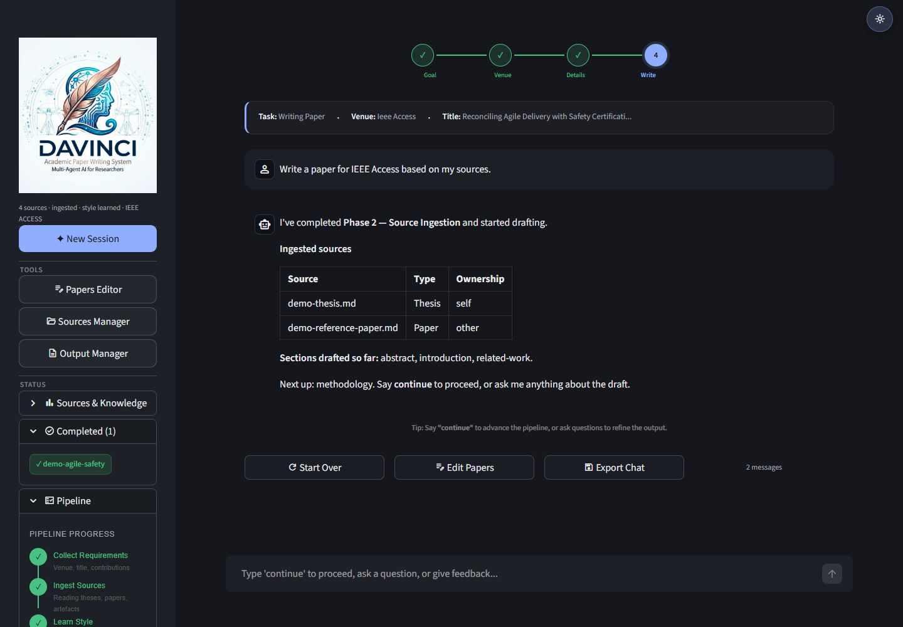

#### Main Area (Chat)

- A **config bar** at the top shows your current task and venue.
- The **chat history** shows all messages between you and DaVinci Writer.
- A **text input** at the bottom lets you ask questions, give feedback, or type **"continue"** to advance the pipeline.

#### Sidebar (Pipeline Progress)

The sidebar shows a **vertical pipeline tracker** with all phases of your selected workflow.

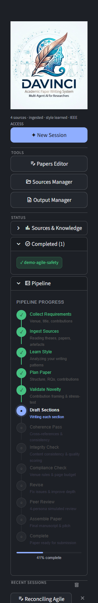

For the "Write a Paper" goal, the tracker shows **13 stages**. Behind them, the orchestrator runs these finer-grained phases:

| # | Tracker stage | What happens (orchestrator phases) |
|---|---------------|------------------------------------|
| 1 | 📋 Collect Requirements | Phases 0–1: confirms venue (mandatory), title, and contributions; checks sources, venue guidelines, and page budget |
| 2 | 📂 Ingest Sources | Phase 2: reads your theses, papers, and artefacts (proposes a title and contributions if not provided) |
| 3 | ✍️ Learn Style | Phase 3: analyzes your published papers for writing patterns |
| 4 | 🗺️ Plan Paper | Phases 2b and 4: paper structure, source-to-section map, and RQ traceability, then **one consolidated Paper Plan approval** (your only pause before drafting besides venue confirmation) |
| 5 | 🔎 Validate Novelty | Phases 4b–4e: novelty validation, contribution framing, and methodology stress-test |
| 6 | 📝 Draft Sections | Phase 5: writes each section |
| 7 | 🔗 Coherence Pass | Coherence pass, "So What?" significance test, figure planning, and the self-plagiarism check (5e) against your prior papers and theses; flagged sections are rewritten (up to 2 automated cycles) |
| 8 | 🔒 Integrity Check | Phase 5f: content consistency and quality scoring; FAIL blocks the compliance check (up to 2 automated fix cycles) |
| 9 | 📏 Compliance Check | Phase 6: validates venue rules and page budget; verifies all citations |
| 10 | 🔄 Revise | Phase 7: fixes issues and improves depth until the check passes |
| 11 | 👥 Peer Review | Phase 8: 4 simulated reviewers critique the paper (the 4th for empirical papers only) |
| 12 | 📄 Assemble Paper | Phases 9–10: creates the final manuscript after your confirmation, with a delivery summary (word counts, page estimate, review verdict) |
| 13 | ✅ Complete | Phase 11: records lessons learned and updates the portfolio tracker |

Other goals show their own, shorter tracker (for example *Read Draft → Analyze Gaps → Expand Sections → … → Complete* for Improve Draft).

The tracker updates automatically. Completed phases show a green ✓, the active phase glows purple, and pending phases appear muted. A progress bar shows the overall percentage.

#### Interacting During Generation

- **Let it run:** DaVinci Writer works through the pipeline automatically.
- **Ask questions:** Type any question in the chat input.
- **Give feedback:** Tell it what to change (e.g., "Make the introduction more concise").
- **Say "continue":** If the AI pauses, type "continue" to move to the next phase.

#### Action Buttons

At the bottom of the chat:

| Button | Action |
|--------|--------|
| 🔄 **Start Over** | Clears everything and returns to Step 1 |
| 📝 **Edit Papers** | Opens the Papers Editor to view and edit generated sections |
| 💾 **Export Chat** | Downloads the full conversation as a Markdown file |

---

## 5. Understanding the Sidebar

The sidebar (left panel) is always visible and organized into clear sections.

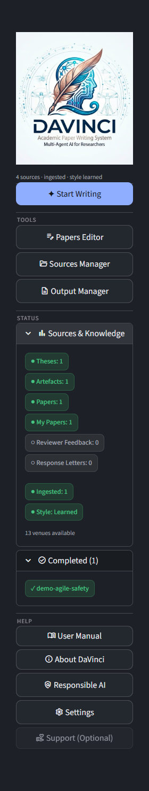

### ✦ Start Writing / ✦ New Session

The primary action button at the top. Starts a fresh session (clears all current state).

### TOOLS

Three navigation buttons that take you to different workspace pages:

| Button | Goes To |
|--------|---------|
| 📝 **Papers Editor** | Draft section editor — view and edit any generated paper section |
| 📂 **Sources Manager** | Source file browser — see and preview all files in `sources/` |
| 📄 **Output Manager** | Output browser — preview, download, and manage all generated files |

### STATUS

Collapsible sections showing your workspace state:

- **📊 Sources & Knowledge** — shows file counts for each source folder (Theses, Artefacts, Papers, My Papers, Reviewer Feedback, Response Letters), how many sources have been ingested, whether your style has been learned, and how many venues are available. After the first generation it also shows this session's token usage and estimated cost, with a small per-turn cost chart. Auto-expands when attention is needed.
- **✅ Completed (n)** — lists papers you've already generated. Only appears once at least one paper exists.
- **📋 Pipeline** — appears during active generation (Step 4) and tracks progress through all pipeline phases.

### RECENT SESSIONS

Shows your 5 most recent saved sessions. Sessions auto-save after every message exchange — close your browser and resume later. Click any session to reload its full state. Each session has a delete (✕) button, and the trash icon in the header clears all saved sessions (click twice to confirm).

### HELP

| Button | Goes To |
|--------|---------|
| 📖 **User Manual** | This user manual |
| ℹ️ **About DaVinci** | Project information and version |
| 🛡️ **Responsible AI** | EU AI Act notice, data-flow details, and AI-use disclosure guidance |
| ⚙️ **Settings** | Provider (Anthropic cloud or local endpoint), API key, model selection, theme, and cost estimates |
| 🤝 **Support (Optional)** | Opens the Ko-fi support page (voluntary tips) |

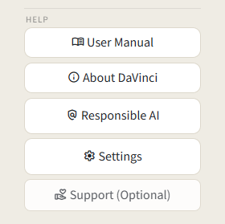
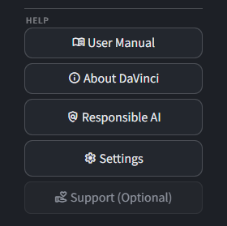

---

## 6. Sources Manager

Access it by clicking **📂 Sources Manager** in the sidebar.

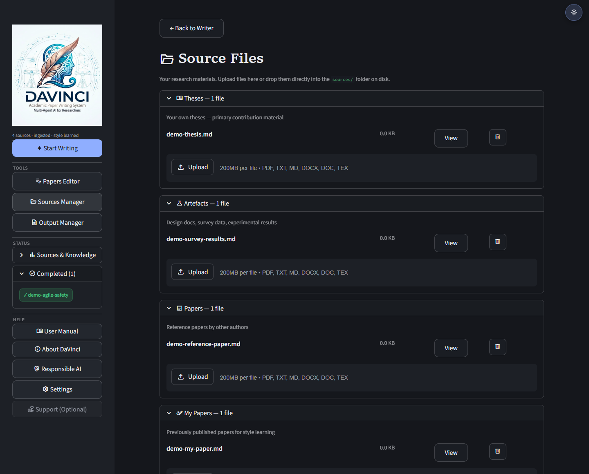

Shows all files in your `sources/` workspace organized by folder:

| Section | Folder | Contents |
|---------|--------|----------|
| 📚 Theses | `sources/theses/` | Your Master's and PhD theses |
| 🔬 Artefacts | `sources/artefacts/` | Design docs, survey data, experiment results |
| 📰 Papers | `sources/papers/` | Reference papers by other authors |
| ✍️ My Papers | `sources/my-papers/` | Your previous publications |
| 📋 Reviewer Feedback | `sources/reviewer-feedback/` | Uploaded reviewer comments |
| 📩 Response Letters | `sources/my-response-letters/` | Your previous rebuttal letters |

Each file shows its size, a **View** button to preview the first 8 KB inline, and a trash button to delete it. Every folder also has an **Upload** slot (PDF, TXT, MD, DOCX, DOC, TEX).

The **Knowledge Base** section below lists ingested source summaries from `output/knowledge/sources/`. These are what the AI actually reads during generation.

> **To add files:** Use the upload slots in Step 3, or copy files directly into the `sources/` subfolder on disk.

---

## 7. Papers Editor

Access it by clicking **📝 Papers Editor** in the sidebar.

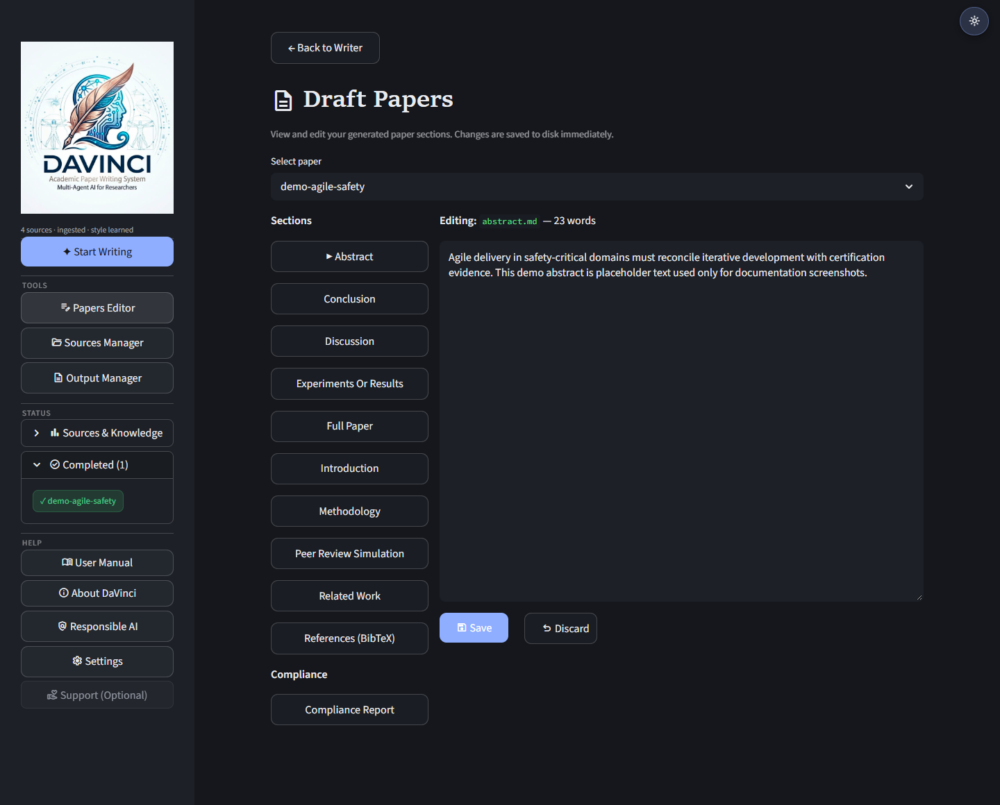

The page is titled **Draft Papers**.

### Selecting a Paper

A dropdown at the top lists all paper slugs in the `output/` folder.

### Section List (left panel)

Lists all Markdown section files for the selected paper in alphabetical order. Compliance reports, revision reports, and the BibTeX file are listed in separate sub-groups. The active section is highlighted with a ▶ prefix.

### Editor (right panel)

- File name and **word count** for the active section
- Full-height text area with the section content
- **💾 Save** — writes changes to disk immediately
- **↩ Discard** — reloads the file from disk, abandoning unsaved edits

---

## 8. Output Manager

Access it by clicking **📄 Output Manager** in the sidebar.

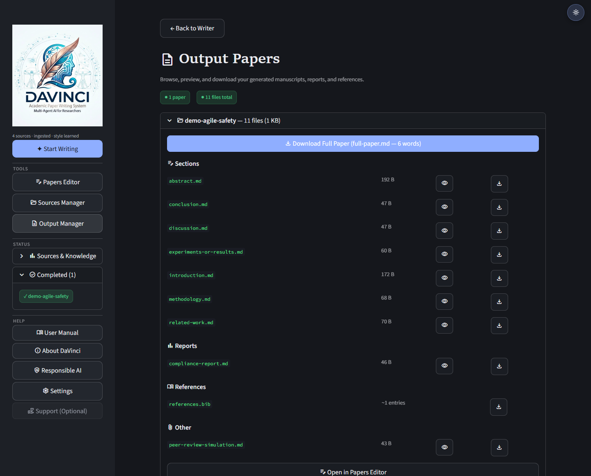

Shows all generated papers organized by folder (the page is titled **Output Papers**). Chips at the top summarize how many papers and files exist. For each paper:
- A prominent **⬇️ Download Full Paper** button for the complete manuscript
- **Sections**, **Reports** (compliance, revision matrix, quality check, etc.), **References** (BibTeX), and **Other** files, each with a preview (👁) and download button
- An **Open in Papers Editor** button to edit the sections directly

---

## 9. Settings

Access it by clicking **⚙️ Settings** in the sidebar (under Help).

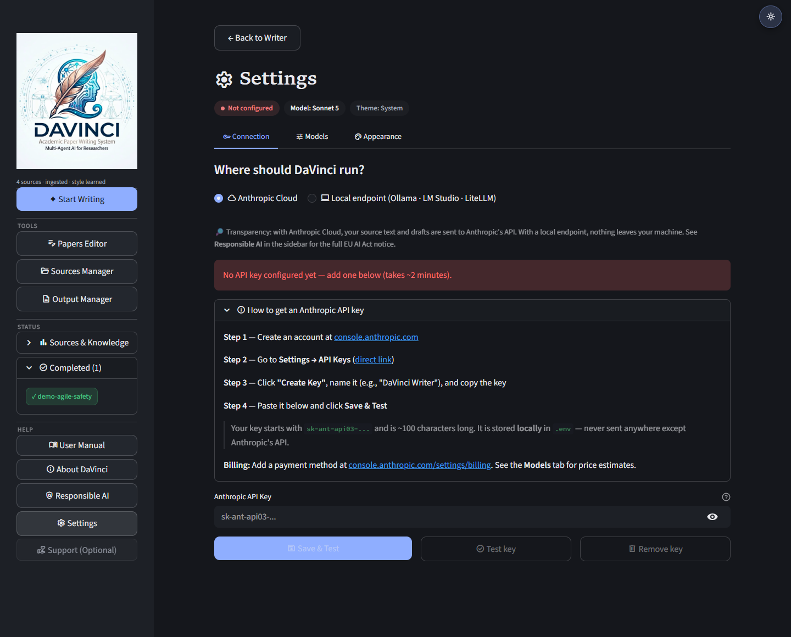
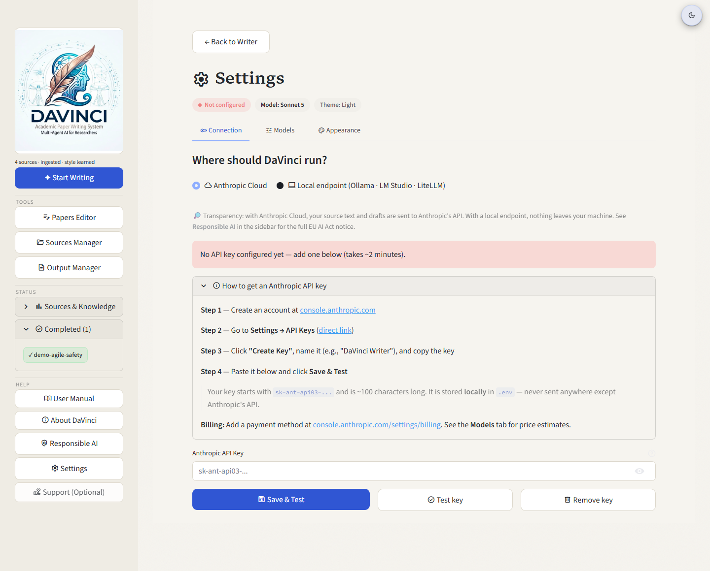

A row of **status chips** at the top summarizes your setup: connection state (Connected / Local endpoint / Not configured), active model, Economy routing, theme mode, and session cost (after first generation).

The Settings page is organized into three tabs:

### 🔑 Connection Tab

First choose **where DaVinci should run**:

- **Anthropic Cloud** — the default. Best quality; requires an API key.
- **Local endpoint** — cost-free generation through a local model server (Ollama, LM Studio, a LiteLLM proxy, or any server that speaks the Anthropic Messages API).

A **transparency note** under the choice reminds you that Anthropic Cloud receives your source text and drafts, while a local endpoint keeps everything on your machine.

**Anthropic Cloud pane:**

- **"How to get a key" guide** — auto-expands if no key is set and walks you through account setup, key generation, and billing
- **API Key input** with **Save & Test** — saves the key and immediately verifies it against Anthropic's API, reporting how many models your account can access
- **Test key** — re-verify an already-saved key at any time
- **Remove key** — two-click confirmation before deleting
- A **✦ Start writing** shortcut appears once you're connected

**Local endpoint pane:**

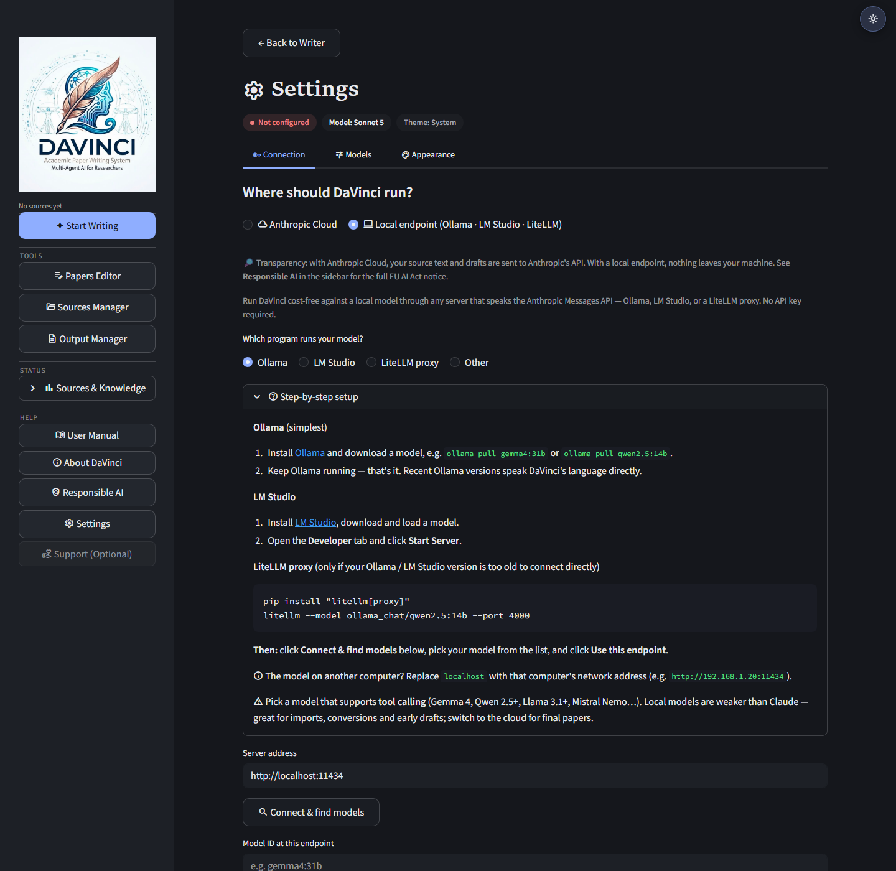
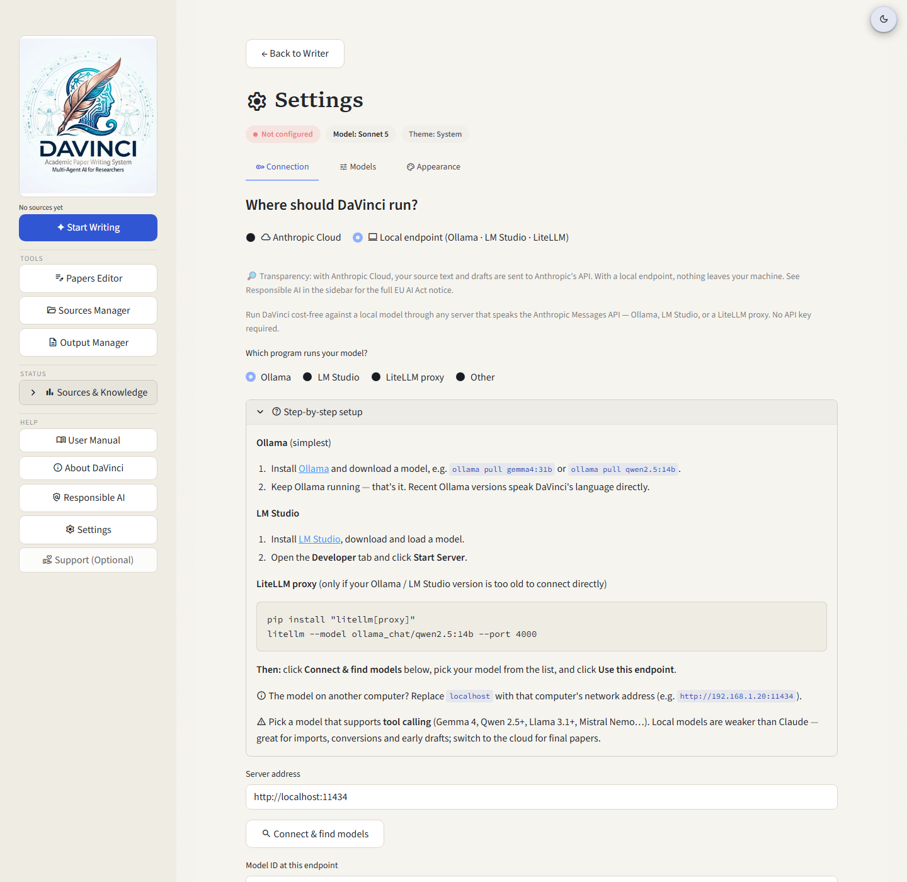

- **Which program runs your model?** — choose **Ollama**, **LM Studio**, **LiteLLM proxy**, or **Other**; the usual server address is filled in automatically (`http://localhost:11434`, `:1234`, `:4000`)
- A built-in **step-by-step setup guide** for each option, including how to reach a model running on another computer on your network
- **Server address** with **Connect & find models** — probes the server and lists the models installed there so you can pick one from a dropdown (or type its name)
- **Use this endpoint** — activates local generation (no API key needed; session cost shows as free)
- **Back to Anthropic cloud** — one click to switch back

> **Tip:** Pick a model that supports **tool calling** (e.g. Gemma 4, Qwen 2.5+, Llama 3.1+, Mistral Nemo). If an older Ollama or LM Studio version will not connect directly, run a LiteLLM proxy in front of it and choose **LiteLLM proxy**.

> **Privacy:** Your API key is stored only in the `.env` file on your machine. It is never sent to any server other than Anthropic's API.
>
> ⚠️ **Local model expectations:** local models are much weaker than Claude on this pipeline (tool-calling reliability, context length, writing quality). They work best for imports, format conversion, and early drafts — switch back to the cloud for final papers.

### 🤖 Models Tab

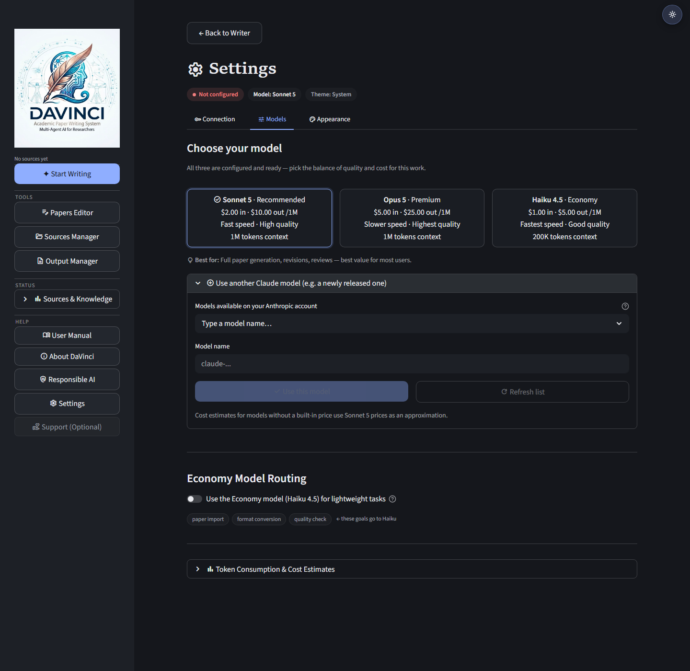
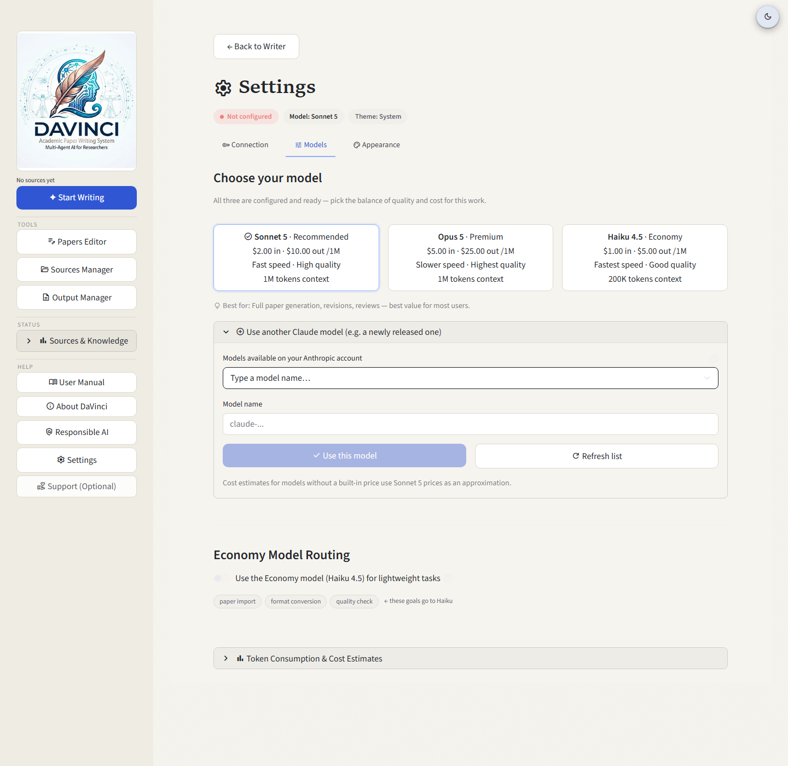

Pick your model from three side-by-side **comparison cards** — each shows the price per million tokens, speed, quality, and context window. Click a card to select it; the active card is highlighted. After a key test, each card also shows whether that model is available on your account.

| Model | Best For | Speed | Cost (per 1M tokens) |
|-------|----------|-------|------|
| **Sonnet 5** (Recommended) | Full paper generation, revisions, reviews | Fast | \$2 in · \$10 out |
| **Opus 5** (Premium) | Complex papers, novel argumentation, final polishing | Slower | \$5 in · \$25 out |
| **Haiku 4.5** (Economy) | Paper import, format conversion, quality checks | Fastest | \$1 in · \$5 out |

**Use another Claude model** — below the cards, this section lists every model available on your Anthropic account (fetched automatically, with a **Refresh list** button), so newly released models such as Sonnet 5.5, Opus 5.5, or Haiku 5.5 can be selected without any update. You can also type a model name. Cost estimates are built in for these newer models; any unknown model is estimated at Sonnet 5 prices.

**Economy Model Routing** — routes lightweight goals (paper import, format conversion, quality check) to Haiku 4.5 while writing, revision, and review stay on your main model. This usually cuts cost without hurting paper quality.

**Token Consumption & Cost Estimates** — expand this section to see your current session's spend plus estimated costs (in USD) for each task with each model.

> **Cost-saving strategy:** Keep Sonnet 5 as your main model, enable Economy routing, and use Opus 5 for final polishing. Prompt caching is automatic on the cloud API and typically cuts input costs by 70–90% in long sessions.
>
> **Note:** While a local endpoint is active, the model cards and Economy routing are disabled — manage your local model in the Connection tab instead.

### 🎨 Appearance Tab

Choose the theme mode: **System** (follows your operating system's light/dark preference), **Dark**, or **Light**. The ☾/☀ toggle in the top bar is a quick override. Changes apply immediately and survive session resets.

---

## 10. Getting Started (VS Code)

If you prefer using VS Code with GitHub Copilot:

### Prerequisites

- **VS Code** — [Download](https://code.visualstudio.com/)
- **GitHub Copilot** extension — install from the VS Code marketplace
- **GitHub Copilot Chat** extension — install from the VS Code marketplace

### Steps

1. Open the DaVinci folder as your workspace in VS Code.
2. Open the **Copilot Chat** panel (click the chat icon in the sidebar, or press `Ctrl+Shift+I`).
3. Type one of these commands:

   ```
   /start
   ```

   This launches a guided wizard that walks you through the same process as the Web UI.

   Or for a fully automated pipeline:

   ```
   /write-paper
   ```

4. Follow the prompts. Your finished paper will appear in the `output/` folder.

### Using GitHub Codespaces

1. Go to the DaVinci repository on GitHub.
2. Click the green **"Code"** button → **"Open with Codespaces"**.
3. Wait for the environment to build (about 2 minutes).
4. Open Copilot Chat and type `/start`.

---

## 11. Preparing Your Source Materials

### Theses (`sources/theses/`)

Your Master's or PhD thesis is the primary source. The AI extracts research questions, methodology, experimental results, and conclusions.

**Best format:** Plain text (.txt) or Markdown (.md). If you have a PDF, the system will extract the text automatically.

### Research Artefacts (`sources/artefacts/`)

Any unpublished materials that support your paper: architecture diagrams, design documents, survey questionnaires, experimental protocols, interview transcripts.

### Reference Papers (`sources/papers/`)

Papers by other authors that you want to cite or compare against. These feed the Related Work section.

### Your Published Papers (`sources/my-papers/`)

Your previously published papers (2–5 is ideal). The AI analyzes these to learn your writing style.

> **Tip:** Provide papers from the same domain. This gives the AI the most relevant style patterns.

### Reviewer Feedback (`sources/reviewer-feedback/`)

Real reviewer comments received after submission. Upload files here or paste them directly in the Revise/Rebuttal wizard steps.

---

## 12. Supported Venues

DaVinci Writer comes with 13 pre-configured venues:

### Journals

| Venue | Publisher | Page Limit | Impact Factor |
|-------|-----------|-----------|---------------|
| IEEE Access | IEEE | No limit (recommended length 15–20 pages) | ~3.4 |
| IEEE TSE | IEEE | 25 pages | ~6.5 |
| Elsevier JSS | Elsevier | No limit | ~3.5 |
| Elsevier IST | Elsevier | No limit | ~3.8 |
| Springer EMSE | Springer | No limit | ~4.0 |

### Conferences

| Venue | Field | Page Limit | Acceptance Rate |
|-------|-------|-----------|----------------|
| ICSE | Software Engineering | 10+2 pages | ~22% |
| ACM FSE | Software Engineering | 12+2 pages | ~22% |
| ACM CHI | Human-Computer Interaction | No hard limit | ~26% |
| IEEE ICASSP | Signal Processing | 4+1 pages | — |
| NeurIPS | Machine Learning / AI | 9 pages | ~26% |
| ICML | Machine Learning | 8 pages | ~26% |
| INForum | Portuguese/English SE | 12 pages (LNCS) | — |
| REFSQ 2027 | Requirements Engineering | 15 pages | Double-blind |

### Adding a Custom Venue

1. Create a folder: `sources/venues/my-conference/`
2. Add a `requirements-summary.md` with the venue's formatting guidelines.
3. It will appear in the Web UI venue picker automatically.

---

## 13. Available Commands (VS Code)

| Command | Description |
|---------|-------------|
| `/start` | Guided wizard — recommended for beginners |
| `/help` | Status dashboard — shows what's configured and what to do next |
| `/write-paper` | Full automated pipeline (ingestion → drafting → review) |
| `/improve-paper` | Expand and polish an existing draft |
| `/new-paper` | Start drafting (sources must already be ingested) |
| `/ingest-sources` | Read and digest source materials |
| `/learn-style` | Analyze your papers to learn your writing style |
| `/set-venue` | Configure the target journal or conference |
| `/set-page-budget` | Compute per-section word targets |
| `/plan-paper` | Generate a paper plan with structure and contributions |
| `/simulate-review` | Get feedback from 4 simulated reviewers |
| `/draft-rebuttal` | Write responses to reviewer comments |
| `/get-feedback` | Process and apply co-author or advisor comments |
| `/plan-agenda` | Identify extractable papers from your research |
| `/prepare-submission` | Generate cover letter, highlights, and checklists |
| `/revise-paper` | Systematic revision based on real peer reviewer feedback |
| `/verify-citations` | Check that all references are real, traceable, and correctly attributed |
| `/check-quality` | Detect AI-generated patterns, overused terms, and style deviations |
| `/lit-review` | Produce a thematic literature map and gap analysis |
| `/convert-format` | Convert a paper between venue formats (e.g., IEEE → Springer) |
| `/coach-revision` | Socratic revision coaching — one reviewer point at a time |
| `/final-audit` | Fresh-context pre-submission verification pass |
| `/import-paper` | Bring an externally-written paper into the workspace |
| `/check-plagiarism` | Compare your paper against prior publications for self-plagiarism |

---

## 14. Tips for Best Results

### Before You Start

1. **Provide your thesis in text format.** PDF conversion can lose formatting. If possible, export your thesis as plain text or Markdown.
2. **Include 2–5 of your published papers** in `sources/my-papers/`. This dramatically improves writing quality by matching your personal style.
3. **Add reference papers** for the Related Work section. The AI will cite them properly.

### During Generation

4. **Be specific with feedback.** Instead of "make it better," say "add more detail about the experimental methodology."
5. **Don't interrupt too early.** Let the AI complete at least one full pipeline phase before giving feedback.
6. **Use "continue" to advance.** If the AI pauses after a phase, type "continue" to move forward.

### After Generation

7. **Review the compliance report.** Check `output/<paper-name>/compliance-report.md` for formatting issues.
8. **Run the peer review.** Even if you're happy with the draft, simulated peer review catches issues you might miss.
9. **Iterate.** You can run "Improve Draft" multiple times to progressively refine the manuscript.

---

## 15. Responsible Use & AI Transparency

DaVinci Writer produces AI-assisted drafts. Before a manuscript leaves your workspace, work through this checklist:

### Disclosure

- **Add an AI-use statement.** The compliance checker auto-generates `output/<paper-name>/ai-disclosure.md` using a template appropriate to your venue. Review and adapt it, then include it in your submission (Acknowledgements, Methods, or a dedicated statement, depending on venue convention).
- **Check your venue's own AI policy first.** Venue rules (in `sources/venues/<venue>/`) can be stricter than general regulation — some require specific wording, others restrict AI-drafted text entirely.
- **See [Responsible AI & EU AI Act Notice](https://github.com/ribeiroe/DaVinci_Writer/blob/main/docs/RESPONSIBLE-AI.md)** for how DaVinci Writer is classified under the EU AI Act and what that means for you as a deployer of the underlying AI model.

### Human-in-the-loop checklist

Before submitting, confirm none of these markers remain unresolved in your draft:

| Marker | Meaning | Action required |
|--------|---------|------------------|
| `[UNSUPPORTED — author to verify]` | Claim has no traceable source | Verify manually or remove the claim |
| `[CITATION NEEDED]` | A claim needs a reference but none was ingested | Add the source and re-cite, or rewrite without the claim |
| `[DATA NEEDED]` | A quantitative value is missing | Supply the real value — never estimate or invent one |
| `[GAP NOT CONFIRMED]` | Novelty vs. prior work wasn't established | Resolve with your own analysis before claiming the contribution |
| `[TODO: baseline required]` | Results section lacks a named baseline | Add the comparison before submission |

Also review the automated reports before relying on them — `citation-verification-report.md`, `quality-scorecard.md`, and `writing-quality-report.md` are safeguards, not certifications. Read them; don't just check that they exist.

### Data handling

- **Anthropic Cloud** — your source text and drafts are sent to Anthropic's API for processing. Your files and API key stay on your machine; only the content needed for each request is transmitted.
- **Local endpoint** (Ollama / LM Studio / LiteLLM) — nothing leaves your machine.
- If your sources include personal data (e.g., study participant records) or sensitive unpublished material, prefer local mode or confirm your cloud provider's terms meet your institution's data protection requirements first.

---

## 16. Frequently Asked Questions

### General

**Q: Do I need to know programming to use DaVinci Writer?**
A: No. The Web UI is a point-and-click interface.

**Q: What AI model does it use?**
A: The Web UI uses Claude by Anthropic. Choose Sonnet 5 (recommended), Opus 5 (premium), or Haiku 4.5 (economy) in **⚙️ Settings → Models** — or any other model on your account (e.g. newer releases) under **Use another Claude model** — or point the app to a local model in **⚙️ Settings → Connection**. In VS Code, it uses the model configured in your GitHub Copilot subscription.

**Q: Is my data sent to the cloud?**
A: When using the Web UI with the Anthropic cloud, your source text is sent to Anthropic's API for processing. Your original files and API key remain on your computer. With a local endpoint, nothing leaves your machine. See **⚙️ Settings → Connection** for details.

**Q: How do I set up the API key?**
A: Open **⚙️ Settings → Connection**, paste your key, and click **Save & Test**. Alternatively, set `ANTHROPIC_API_KEY` in a `.env` file in the DaVinci folder.

**Q: Can I use it offline?**
A: Yes, with a local model. Choose **Local endpoint** in **⚙️ Settings → Connection** and follow the built-in setup guide (Ollama, LM Studio, or LiteLLM). Generation then runs on your machine at no cost. Expect lower quality than cloud models; Anthropic cloud requires an internet connection.

**Q: How can I support the project?**
A: In the sidebar **Help** section, click **Support (Optional)**. You can also use the support card on the **About DaVinci** page, or the one-time hint shown when a pipeline completes. Tips are voluntary and help cover development, maintenance, and hosting costs.

### Papers & Output

**Q: Where are my generated papers saved?**
A: In the `output/` folder. Each paper gets its own subfolder (e.g., `output/my-paper-ieee-access/`).

**Q: What format is the output?**
A: Markdown (.md) files. Convert to LaTeX, Word, or PDF using Pandoc: `pandoc full-paper.md -o paper.tex`

**Q: Can I write multiple papers?**
A: Yes. Each paper gets its own folder. Start a new session from the sidebar for each new paper.

**Q: Can I edit the generated paper?**
A: Yes. Click **📝 Papers Editor** in the sidebar, select a section, edit it, and click **💾 Save**.

### Venues & Formatting

**Q: What if my venue isn't in the list?**
A: Use the **"🔧 Use a different venue"** option in Step 2, or add a requirements file to `sources/venues/`.

**Q: Does it produce LaTeX output?**
A: Primary output is Markdown. For LaTeX: `pandoc output/paper/full-paper.md -o paper.tex`

### Style & Quality

**Q: How good is the writing?**
A: The AI produces scholarly prose suitable for peer review. It works best when it has your style profile from `sources/my-papers/` and when you provide iterative feedback.

**Q: Will it plagiarize?**
A: No. The AI generates original text. Always run your own plagiarism check before submission.

**Q: Can co-authors use it too?**
A: Yes. Share the workspace folder. Co-authors can add their feedback using the "Integrate Feedback" goal.

---

## 17. Troubleshooting

### Web UI Issues

| Problem | Solution |
|---------|----------|
| "API key not configured" | Open **⚙️ Settings → Connection**, paste your key, and click **Save & Test**. Or create a `.env` file in the DaVinci root with `ANTHROPIC_API_KEY=sk-ant-...` |
| Local endpoint not responding | Click **Connect & find models** in **⚙️ Settings → Connection** — make sure Ollama / LM Studio (or your LiteLLM proxy) is running and the address includes the port, e.g. `http://localhost:11434` (Ollama), `:1234` (LM Studio), `:4000` (LiteLLM) |
| Page won't load | Make sure Streamlit is running: `streamlit run web/app.py`, use `Start DaVinci.command` (macOS), use `start.bat` (Windows), or run the OS-specific scripts in `scripts/macos/` or `scripts/windows/` |
| Upload fails | Check that the `sources/` folders exist and are writable |
| "Module not found" error | Run `pip3 install -r web/requirements.txt` |
| `.command` file blocked by macOS | Right-click → Open → Open (one-time only) |
| PDF text extraction fails | Convert the PDF to text first: `pdftotext paper.pdf paper.txt` |

### VS Code Issues

| Problem | Solution |
|---------|----------|
| Commands not recognized | Make sure GitHub Copilot and Copilot Chat extensions are installed and active |
| "No agent found" | Open the DaVinci folder as your workspace root (not a parent folder) |
| Copilot Chat is empty | Sign in to GitHub Copilot (click the Copilot icon in the status bar) |

### General Issues

| Problem | Solution |
|---------|----------|
| Poor writing quality | Add more source materials and your published papers for style learning |
| Paper too short | Use "Improve Draft" to expand sections |
| Wrong formatting | Check that you selected the correct venue |
| Missing citations | Add reference papers to `sources/papers/` and re-run |
| Session lost | Recent sessions are listed in the sidebar — click to resume |

---

## 18. Credits & How to Cite

- **Author**: J. Eduardo Ferreira Ribeiro
- **Contributors**: António Campos, Nuno Pessoa Soares

If DaVinci Writer helped produce a paper, thesis, or report, please cite it as:

```bibtex
@software{ribeiro2026davinci,
  author  = {Ferreira Ribeiro, J. Eduardo and Campos, António and Pessoa Soares, Nuno},
  title   = {DaVinci Writer: An AI-Powered Multi-Agent System for Academic Paper Writing},
  year    = {2026},
  version = {1.1.0},
  url     = {https://github.com/ribeiroe/DaVinci_Writer}
}
```

The AI research failure-mode checks are based on Lu et al. (2026), *Nature* 651:914–919. See the **About DaVinci** page for the full credits, including the AI models and frameworks the Web UI relies on.

---

## Workspace Folder Structure

```
DaVinci/
├── sources/
│   ├── theses/          ← Your thesis (PDF, TXT, or MD)
│   ├── artefacts/       ← Your research data, designs, notes
│   ├── papers/          ← Reference papers by other authors
│   ├── my-papers/       ← Your published papers (for style learning)
│   ├── my-response-letters/ ← Previous rebuttal letters
│   ├── submitted-papers/    ← Papers imported for revision
│   ├── reviewer-feedback/   ← Real reviewer comments
│   └── venues/          ← Conference/journal guidelines
│       ├── ieee-access/
│       ├── icse/
│       └── ...
├── output/              ← Generated manuscripts
│   ├── my-paper/
│   │   ├── abstract.md
│   │   ├── introduction.md
│   │   ├── related-work.md
│   │   ├── methodology.md
│   │   ├── experiments-or-results.md
│   │   ├── discussion.md
│   │   ├── conclusion.md
│   │   ├── full-paper.md
│   │   ├── references.bib
│   │   └── compliance-report.md
│   └── knowledge/       ← Persistent AI knowledge (do not delete)
│       ├── sources/     ← Ingested source summaries
│       └── style-profile.md
├── Start DaVinci.command  ← Double-click to launch (macOS)
├── Stop DaVinci.command   ← Double-click to stop (macOS)
├── start.bat              ← Double-click to launch (Windows)
├── stop.bat               ← Double-click to stop (Windows)
├── scripts/
│   ├── macos/
│   │   ├── run-webui.command
│   │   └── stop-webui.command
│   └── windows/
│       ├── run-webui.bat / run-webui.ps1
│       └── stop-webui.bat / stop-webui.ps1
├── web/                 ← Web UI application
├── docs/                ← Documentation, manual, images
│   ├── QUICKSTART.md    ← 3-step quick start guide
│   ├── ABOUT.md         ← Project overview and version info
│   ├── ARCHITECTURE.md  ← Detailed system design
│   ├── RESPONSIBLE-AI.md ← Responsible AI & EU AI Act notice
│   └── USER-MANUAL.md   ← This file
├── Dockerfile / docker-compose.yml ← Optional container setup
├── .env.example         ← Template for your API key and local-endpoint settings
├── AGENTS.md            ← Agent definitions (read by GitHub Copilot)
├── CLAUDE.md            ← Points to AGENTS.md (read by Claude Code)
└── README.md            ← Project overview
```

